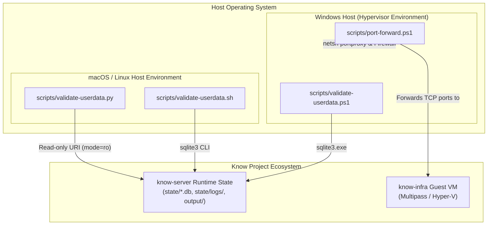
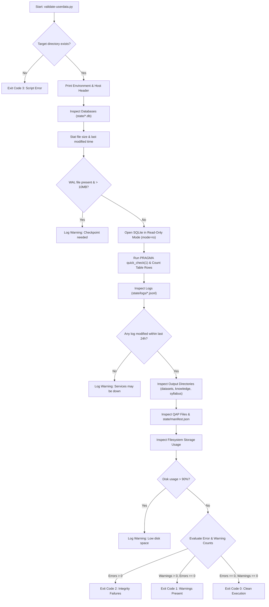

# Architecture — know-tools

## Overview & Architectural Scope

The `know-tools` repository aggregates cross-component operational tooling and host hypervisor utility scripts for the Know project ecosystem. Tools reside in `know-tools` when they satisfy one of two architectural criteria:
1. **Cross-Repository Operations**: Tools that process or transfer artifacts between separate repositories (e.g., syncing private component sources to public open-source target repositories).
2. **Host-Level Automation**: Tools that execute directly on the host operating system rather than inside guest virtual machines or container runtimes (e.g., configuring Windows host network proxies and firewall rules for guest VMs).

Component-specific operational tasks remain localized inside their respective component repositories (such as `knowctl` inside `know-server`). `know-tools` maintains zero runtime dependencies on component application code.

---

## System Architecture



---

## Directory Structure

```text
know-tools/
├── ARCHITECTURE.md          # Comprehensive architectural reference document
├── README.md                # Root user documentation and quick start guide
├── pyproject.toml           # Python environment specification (Hatchling build backend)
└── scripts/                 # Operational validation and host network proxy automation
    ├── README.md            # Subdirectory documentation for scripts/
    ├── port-forward.ps1     # Windows PowerShell netsh portproxy and firewall manager
    ├── validate-userdata.ps1# Windows PowerShell read-only state validator for know-server
    ├── validate-userdata.py # Cross-platform Python read-only state validator for know-server
    └── validate-userdata.sh # POSIX bash fallback read-only state validator for know-server
```

---

## Module Reference

### State Validation & Host Operations Subsystem (`scripts/`)

- **`scripts/validate-userdata.py`**: Cross-platform Python 3.10+ validator inspecting `know-server` runtime data ([`scripts/validate-userdata.py:1`](scripts/validate-userdata.py#L1)).
  - Uses `file:<path>?mode=ro` SQLite connection URIs to prevent WAL checkpointing or side-effect writes ([`scripts/validate-userdata.py:38`](scripts/validate-userdata.py#L38)).
  - Inspects 5 core databases: `app.db`, `content.db`, `users.db`, `tasks.db`, `server.db` ([`scripts/validate-userdata.py:22`](scripts/validate-userdata.py#L22)).
  - Validates SQLite integrity via `PRAGMA quick_check(1);` and table row counts ([`scripts/validate-userdata.py:133-148`](scripts/validate-userdata.py#L133-L148)).
  - Verifies log files in `state/logs/*.jsonl` (warns if no log modified in last 24h) ([`scripts/validate-userdata.py:160-192`](scripts/validate-userdata.py#L160-L192)).
  - Audits dataset, knowledge, and syllabus outputs in `output/` ([`scripts/validate-userdata.py:194-210`](scripts/validate-userdata.py#L194-L210)).
  - Checks QAP archives and `state/manifest.json` ([`scripts/validate-userdata.py:212-234`](scripts/validate-userdata.py#L212-L234)).
  - Monitors host disk utilization via `shutil.disk_usage` (warns if > 90%) ([`scripts/validate-userdata.py:236-249`](scripts/validate-userdata.py#L236-L249)).

- **`scripts/validate-userdata.sh` & `scripts/validate-userdata.ps1`**: Native shell and PowerShell implementations mirroring validation rules for environments without standard Python runtimes ([`scripts/validate-userdata.sh:1`](scripts/validate-userdata.sh#L1), [`scripts/validate-userdata.ps1:1`](scripts/validate-userdata.ps1#L1)).

- **`scripts/port-forward.ps1`**: Windows host network utility requiring PowerShell 5.1+ and Administrator rights ([`scripts/port-forward.ps1:1-2`](scripts/port-forward.ps1#L1-L2)).
  - Resolves target VM IP dynamically using `multipass info know-infra --format json` (falling back to `172.26.60.57`) ([`scripts/port-forward.ps1:87-95`](scripts/port-forward.ps1#L87-L95)).
  - Ensures Windows IP Helper service (`iphlpsvc`) is active ([`scripts/port-forward.ps1:60-75`](scripts/port-forward.ps1#L60-L75)).
  - Manages 5 target TCP port forwards: `3001` (Gitea HTTP), `2222` (Gitea SSH), `4317` (OTLP gRPC), `4318` (OTLP HTTP), `3000` (Grafana UI) ([`scripts/port-forward.ps1:41-47`](scripts/port-forward.ps1#L41-L47)).
  - Synchronizes Windows Firewall rules scoped to `LocalSubnet` ([`scripts/port-forward.ps1:136-149`](scripts/port-forward.ps1#L136-L149)).

---

## Data Flow & Lifecycles

### Runtime User Data Validation Lifecycle



---

## Design Decisions

1. **Zero Runtime Dependencies**: All Python tooling relies exclusively on standard library modules (`sqlite3`, `json`, `shutil`, `socket`, `argparse`). This eliminates setup overhead and prevents version conflicts across developer environments.
2. **Strict Read-Only Database Inspection**: `validate-userdata.py` enforces SQLite URI connections with `mode=ro` ([`scripts/validate-userdata.py:38`](scripts/validate-userdata.py#L38)). This guarantees that inspection scripts never write to SQLite WAL journals, trigger automatic checkpoints, or lock production databases.
3. **Idempotent Windows Network Automation**: `port-forward.ps1` verifies service dependencies (such as `iphlpsvc`) and existing firewall rules before modifying system state. The `refresh` and `up` actions atomically overwrite outdated `netsh portproxy` rules.
4. **Multi-Platform Fallback Implementations**: State validation is implemented in Python, POSIX Bash, and Windows PowerShell to support restricted host environments where specific runtime interpreters may be unavailable.

---

## Non-Goals & Invariants

- **No Application Business Logic**: `know-tools` does not contain application code or component libraries.
- **No Standalone PyPI Distribution**: `pyproject.toml` explicitly disables wheel package inclusion (`packages = []`, [`pyproject.toml:13`](pyproject.toml#L13)).
